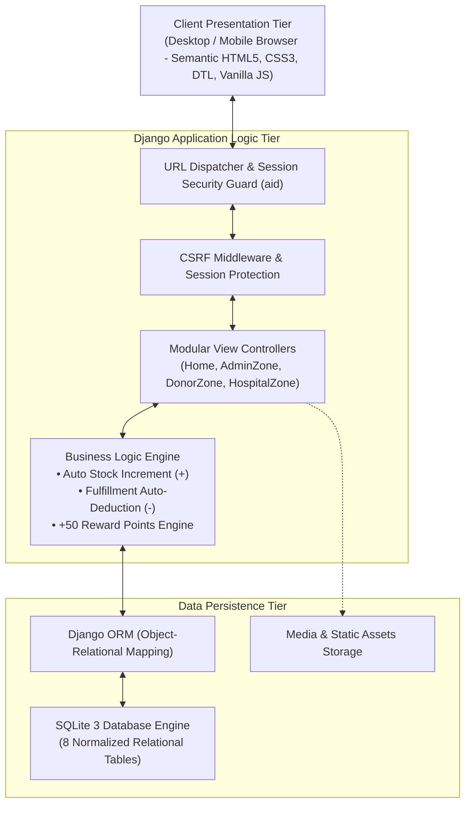

# 🩸 HemoCampus — Centralized Blood Bank & Clinical Hospital Requisition System

[](https://www.python.org/)
[](https://www.djangoproject.com/)
[](https://www.sqlite.org/)
[](https://github.com/Code-Pankaj-dev/HemoCampus)
[](LICENSE)

> **A modern, full-stack healthcare web application designed to bridge the critical gap between voluntary blood donors, partner hospitals, and centralized blood bank administrators in real time.**

---

## 📌 Table of Contents

- [Overview](#-overview)
- [Key Architectural Highlights](#-key-architectural-highlights)
- [Multi-Stakeholder Portals & Features](#-multi-stakeholder-portals--features)
- [System Architecture (3-Tier MVT)](#-system-architecture-3-tier-mvt)
- [Tech Stack](#-tech-stack)
- [Database Schema & ER Relationships](#-database-schema--er-relationships)
- [Project Directory Structure](#-project-directory-structure)
- [Getting Started & Installation](#-getting-started--installation)
- [Default Demo Credentials](#-default-demo-credentials)
- [Automated Testing & Quality Verification](#-automated-testing--quality-verification)
- [Academic Deliverables & Presentation](#-academic-deliverables--presentation)
- [Future Roadmap](#-future-roadmap)
- [Author & Acknowledgments](#-author--acknowledgments)

---

## 🌟 Overview

In critical medical emergencies, traumas, and scheduled surgical procedures, finding compatible blood units quickly can mean the difference between life and death. Traditional blood banking methods rely on scattered phone calls, manual paper registers, and physical coordination—often creating a 45- to 60-minute procurement delay.

**HemoCampus** eliminates this bottleneck by providing a centralized digital web platform where:
1. **Voluntary Donors** can log their blood donations in-portal, track health eligibility, earn gamified reward points (`+50 pts`), and place emergency requisitions for their family.
2. **Partner Hospitals** can view live 8-group blood stock telemetry, place standard surgery requisitions, and dispatch **8-minute Emergency SOS (🚨)** requisitions.
3. **Central Administrators** have complete command over 8-group blood inventories, donor verification pipelines (Approve/Reject), and single-click order fulfillment with **automated inventory deduction**.

---

## 🚀 Key Architectural Highlights

* 🔄 **Automated Stock Synchronization**: Whenever a donor records a donation in-portal, central inventory (`BloodStock`) increments automatically. When an admin fulfills a hospital order, units auto-deduct in real time.
* 🚨 **Dual-Priority Ordering (Normal vs. Emergency SOS)**: Hospitals can flag critical trauma orders as `Emergency SOS`, which automatically highlights at the top of the admin triage queue with high visual priority.
* 🏆 **Donor Gamification Engine**: Voluntary donors earn +50 reward points per donation, receive 90-day cooling-period eligibility alerts, and view lifetime donation stats.
* 🛡️ **Session-Based Role-Based Access Control (RBAC)**: Secure multi-role authentication gateway (`/login/`) isolates Admin, Donor, and Hospital portals, automatically preventing unauthorized cross-role access.
* 📱 **Modern Glassmorphic Responsive UI**: Semantic HTML5, CSS Grid/Flexbox, custom mobile drawer navigation, responsive table wrappers (`.table-wrap`), and in-portal popup modal controllers.

---

## 👥 Multi-Stakeholder Portals & Features

```
┌────────────────────────────────────────────────────────────────────────────────────────┐
│                                HEMOCAMPUS USER ROLES                                   │
├────────────────────────────────────────────────────────────────────────────────────────┤
│  1. 🌐 Public Community Visitor                                                        │
│     • Interactive Blood Compatibility Matrix (Universal Donor O- / Recipient AB+)      │
│     • Live Blood Stock Telemetry Ticker & 4-Step Donation Guide                        │
│     • Blood Center Directory & Voluntary Donor Registration Portal                     │
├────────────────────────────────────────────────────────────────────────────────────────┤
│  2. 🩸 Voluntary Blood Donor (`/donor-dashboard/`)                                     │
│     • In-Portal "Record Donation" Modal with auto +50 Reward Points                    │
│     • Donation History Log with date, hospital name, and status badges                 │
│     • Emergency Family Blood Requisition Placement Modal                               │
│     • In-App Notification Feed & 90-Day Medical Cooling Period Countdown               │
├────────────────────────────────────────────────────────────────────────────────────────┤
│  3. 🏥 Partner Clinical Hospital (`/hospital-dashboard/`)                              │
│     • Live 8-Blood-Group Central Inventory Telemetry Progress Grid                     │
│     • Standard Elective Surgery Requisition Modal                                      │
│     • 8-Minute Emergency SOS Requisition Dispatch Channel (🚨)                         │
│     • Real-time Requisition Status Tracker (`Pending` -> `Approved` -> `Fulfilled`)    │
├────────────────────────────────────────────────────────────────────────────────────────┤
│  4. 👨‍💼 Central System Administrator (`/Admin_Dashboard/`)                             │
│     • Executive KPI Dashboard (Total Donors, Hospitals, Active Orders, Stock Units)    │
│     • 8-Group Blood Stock Manager (`/Blood_Stock/`) with Quick Delta (+ / -) Controls  │
│     • Voluntary Donor Verification Queue (`/Manage_Donors/`) — Approve, Reject, Delete │
│     • Hospital Order Fulfillment Engine with Automatic Stock Deduction                 │
│     • Printable Operational Analytics & Requisition Reports (`/Report_Analytics/`)     │
└────────────────────────────────────────────────────────────────────────────────────────┘
```

---

## 🏗️ System Architecture (3-Tier MVT)



---

## 💻 Tech Stack

| Layer | Technologies & Tools |
| :--- | :--- |
| **Frontend** | HTML5, CSS3 (Custom Glassmorphism, Responsive Grids), Vanilla JavaScript ES6+, Django Template Language (DTL), FontAwesome 6.6.0, Google Fonts |
| **Backend** | Python 3.10 / 3.12 / 3.14, Django Web Framework (MVT Architecture), Custom Session Auth Controller (`loginCode`), CSRF Protection |
| **Database** | SQLite 3 (Django ORM with Normalized Models, Foreign Keys, Schema Migrations Pipeline) |
| **Testing** | Django Test Client Integration Suite (`test_complete_verification.py`), Automated Endpoint Verification |
| **DevOps & Tools** | VS Code / Antigravity IDE, PowerShell, Git, GitHub, `python-pptx`, `Pillow`, `XlsxWriter` |

---

## 🗄️ Database Schema & ER Relationships

The project includes **8 core relational models** organized across modular Django apps:

* `BloodStock` — Centralized 8 blood group inventory counters (`A+`, `A-`, `B+`, `B-`, `AB+`, `AB-`, `O+`, `O-`) with dynamic `@property status_level` (`high`, `medium`, `low`).
* `Donor` & `DonationHistory` — Donor profiles with reward points, 90-day cooling calculation, and 1-to-Many cascade link to historical donation records.
* `DonorBloodRequest` — Family emergency requests placed directly by donors from within their portal.
* `DonorNotification` — Real-time in-app notification feed for donors.
* `Hospital` & `BloodRequest` — Clinical hospital facility accreditation data with 1-to-Many cascade link to blood requisitions with priority tag (`Normal` vs `Emergency`).
* `DonorRegisterModel` — Admin-side donor medical verification log with health screening declarations.
* `LoginModel` — Multi-role authentication credentials table (`admin`, `donor`, `hospital`).
* `ContactModel` — Public inquiries, contact messages, and emergency helpline log.

---

## 📂 Project Directory Structure

```
HemoCampus/
├── hemocampus/              # Core Django Project Configuration
│   ├── __init__.py
│   ├── asgi.py
│   ├── settings.py          # Installed Apps, Middleware, Templates, Static & Media Config
│   ├── urls.py              # Root URL Routing & Global Admin Action Dispatchers
│   └── wsgi.py
├── Home/                    # Public Web App & Unified Authentication
│   ├── models.py
│   ├── urls.py              # Public routes (/about, /donate, /contact, /login, /register)
│   └── views.py             # Public page rendering, loginCode gateway, registrations
├── AdminZone/               # Admin Management & Central Inventory Control
│   ├── models.py            # BloodStock, DonorRegisterModel, ContactModel, LoginModel
│   ├── urls.py              # /Admin_Dashboard, /Manage_Donors, /Manage_Request, /Blood_Stock
│   └── views.py             # Stock adjustments, donor approvals, order fulfillment auto-deduction
├── DonorZone/               # Donor Portal & In-Portal Service
│   ├── models.py            # Donor, DonationHistory, DonorBloodRequest, DonorNotification
│   ├── urls.py              # /donor-dashboard, /donor-dashboard/donate-blood/
│   └── views.py             # In-portal donation logger (+50 pts), requisition placement
├── HospitalZone/            # Hospital Portal & Clinical SOS Requisitions
│   ├── models.py            # Hospital, BloodRequest
│   ├── urls.py              # /hospital-dashboard, /hospital-dashboard/request-blood/
│   └── views.py             # Telemetry inspection, Normal & Emergency SOS orders
├── templates/               # Presentation Layer (22 DTL HTML Templates)
│   ├── AdminPages/          # Admin Dashboard, Blood Stock, Manage Donors, Reports
│   ├── DonorPages/          # In-Portal Donor Dashboard with Embedded Modals
│   ├── HospitalPages/       # Hospital Dashboard with Emergency Requisition Modals
│   ├── master.html          # Public Base Master Template
│   ├── index.html           # Public Landing Page & Compatibility Matrix
│   └── login.html           # Unified Multi-Role Authentication Interface
├── static/                  # CSS stylesheets, JavaScript files, Brand Graphics
├── media/                   # User-uploaded Hospital Licenses & Medical Certificates
├── db.sqlite3               # SQLite 3 Database (Pre-seeded with Default Demo Accounts)
├── requirements.txt         # Project Dependencies
├── HemoCampus_Project_Presentation_FINAL.pptx # 48-Slide Academic PPTX
├── HemoCampus_Devanagari_Viva_Questions.md    # 50 Categorized Viva Q&A
└── README.md                # Project Documentation
```

---

## ⚡ Getting Started & Installation

### 1. Clone the Repository
```bash
git clone https://github.com/Code-Pankaj-dev/HemoCampus.git
cd HemoCampus
```

### 2. Create and Activate Virtual Environment (Recommended)
```bash
# Windows
python -m venv venv
venv\Scripts\activate

# Linux / macOS
python3 -m venv venv
source venv/bin/activate
```

### 3. Install Dependencies
```bash
pip install -r requirements.txt
```

### 4. Apply Database Migrations
```bash
python manage.py makemigrations
python manage.py migrate
```

### 5. Run the Development Server
```bash
python manage.py runserver
```
Now open your browser and navigate to: **`http://127.0.0.1:8000/`**

---

## 🔑 Default Demo Credentials

You can test the entire platform using the following pre-configured demo credentials:

| Role | Portal URL | Email / Username | Password |
| :--- | :--- | :--- | :--- |
| **👑 System Admin** | `http://127.0.0.1:8000/Admin_Dashboard/` | `admin@gmail.com` | `12` |
| **🩸 Voluntary Donor** | `http://127.0.0.1:8000/donor-dashboard/` | `donor@gmail.com` | `1234` |
| **🏥 Partner Hospital** | `http://127.0.0.1:8000/hospital-dashboard/` | `hospital@gmail.com` | `12345` |

---

## 🧪 Automated Testing & Quality Verification

HemoCampus features an automated integration test suite that programmatically validates all **29 endpoints** and **9 core full-stack workflows**:

```bash
# Run complete system integration test
python scratch/test_complete_verification.py
```

### Test Coverage Results:
* ✅ 11 Public Endpoints (`/`, `/about/`, `/donate/`, `/contact/`, `/login/`, etc.) — `HTTP 200 OK`
* ✅ Multi-Role Authentication & Session Initialization (`Admin`, `Donor`, `Hospital`) — `PASS`
* ✅ In-Portal Donor Donation Logging & `+50 Reward Points` Calculation — `PASS`
* ✅ Hospital Requisition Placement & Emergency SOS Dispatch (🚨) — `PASS`
* ✅ Admin Requisition Fulfillment with **Automated Stock Deduction** — `PASS`
* ✅ Role-Based Route Guarding (Unauthorized Anonymous Access Blocked) — `PASS`
* 🎯 **Overall Result: 100% Pass Rate (0 Errors across 29 Endpoints).**

---

## 📊 Academic Deliverables & Presentation

Inside this repository, you will find ready-to-use academic defense deliverables:

1. **`HemoCampus_Project_Presentation_FINAL.pptx`**:
   * **48 Slides** in 16:9 Widescreen format.
   * Full technical breakdown (Architecture, DFD, ER diagram, ORM queries, Security, Testing).
   * Word-for-word **देवनागरी Hinglish Speaker Notes** on every single slide for presenter view during viva.
2. **`HemoCampus_Devanagari_Viva_Questions.md`**:
   * Comprehensive guide containing **50 Categorized Technical Viva Questions & Answers**.
   * Features the **Top 20 Examiner Favorite Questions** covering MVT, ORM, CSRF, Auto-Stock Deduction, and RBAC.

---

## 🚀 Future Roadmap

* [ ] **SMS & WhatsApp Dispatch Gateway**: Integrate Twilio / Fast2SMS API for instant blood drive and emergency SOS alerts.
* [ ] **Live GPS Courier Vehicle Tracking**: Google Maps Platform integration for real-time blood delivery tracking.
* [ ] **Cloud Database Migration**: Deploy with PostgreSQL, Gunicorn, Nginx, and Docker on AWS / DigitalOcean.
* [ ] **IoT Cold-Chain Sensors**: Hardware temperature logging for stored blood bag preservation.

---

## 👨‍💻 Author & Acknowledgments

* **Developer**: Pankaj ([@Code-Pankaj-dev](https://github.com/Code-Pankaj-dev))
* **Project**: HemoCampus — Major Final Year Academic Project (Computer Science & Engineering)
* **Framework**: Built with ❤️ using [Django](https://www.djangoproject.com/) and [Python](https://www.python.org/).

---
*⭐ If you find this project useful for academic reference or healthcare applications, please give this repository a star!*
